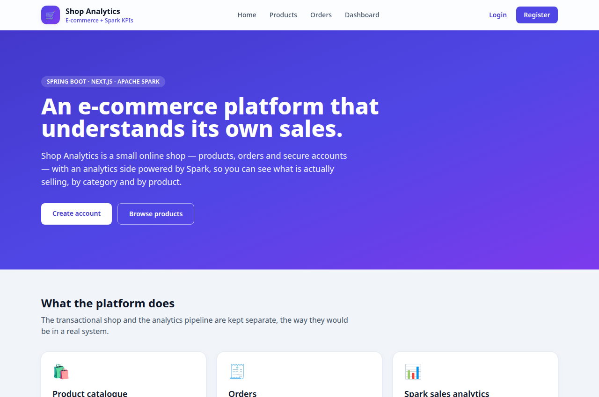
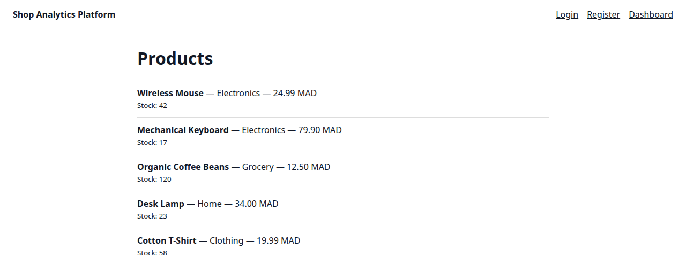
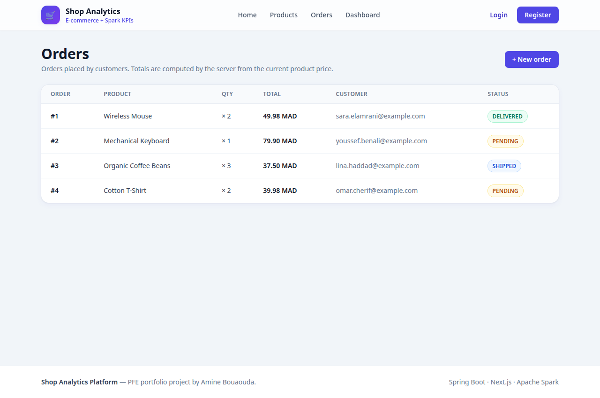
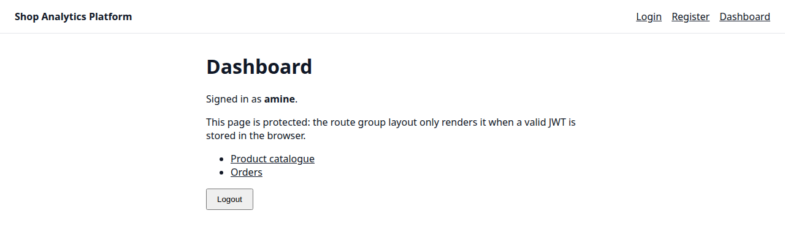

# Shop Analytics Platform

An e-commerce platform with sales analytics, built as a PFE portfolio project.

The idea is simple: a small online shop (products, orders) plus an analytics
side that processes sales data to show what is actually selling — revenue by
category, best-selling products, and trends over time. The transactional part
and the analytics part are kept separate, the way they would be in a real system.

## Screenshots

The app running locally, with sample data:

**Home page** (`/`)



**Product catalogue** (`/products`, login required)



**Orders** (`/orders`, login required)



**Dashboard** (`/dashboard`, login required)



## Tech Stack

**Backend**
- Java 17, Spring Boot 3
- Spring Web, Spring Data JPA, Spring Security, Bean Validation
- PostgreSQL

**Frontend**
- Next.js 14 (App Router), React 18, TypeScript
- Tailwind CSS

**Big Data**
- Apache Spark (PySpark) for batch sales analysis
- Hadoop / HDFS — planned, see `big-data/README.md`
- CSV as the starting data format, before moving to a data lake layout

**Infra**
- Docker Compose for local development (PostgreSQL by default; Hadoop HDFS + Spark under the `bigdata` profile)

## Architecture Overview

```
shop-analytics-platform/
├── backend/     Spring Boot REST API — products, orders, auth (later)
├── frontend/    Next.js web app — storefront and analytics dashboard (later)
└── big-data/    Spark jobs that read order data and compute sales KPIs
```

Flow (target architecture):

1. A customer places an order through the Next.js frontend.
2. The Spring Boot backend validates it and stores it in PostgreSQL.
3. Order data is exported to CSV / HDFS.
4. A Spark job aggregates it (for example total revenue per category).
5. Aggregated results are displayed in the dashboard.

Day 1 only sets up the skeleton of this flow. The endpoints, UI pages, and
Spark logic are added step by step in the roadmap below.

## How to Run (Day 1)

### Prerequisites
- Docker and Docker Compose
- Java 17 and Maven (to run the backend locally)
- Node.js 18+ and npm (to run the frontend locally)

### 1. Start the database

```bash
docker compose up -d postgres
```

This starts PostgreSQL on `localhost:5432`
(database: `shopanalytics`, user: `shop`, password: `shop_dev_password`).

### 1b. Start the Big Data profile (optional)

```bash
docker compose --profile bigdata up -d
```

This starts PostgreSQL plus the Hadoop NameNode and DataNode. The
`bigdata` profile is optional on purpose: the default `docker compose up`
stays light. NameNode web UI: http://localhost:9870 — HDFS address:
`hdfs://localhost:9000`.

```bash
# Check HDFS is up
docker compose --profile bigdata exec namenode hdfs dfs -ls /

# Run the Spark job inside a container (one-shot, not a daemon)
docker compose --profile bigdata run --rm spark \
  spark-submit spark/sales_analysis.py data/sample_orders.csv

# Stop everything
docker compose down
```

The Spark job still reads local CSV files by default; reading its input
from HDFS is the next step (see `big-data/README.md`).

### 2. Run the backend

```bash
cd backend
./mvnw spring-boot:run
# or, if you use a system Maven install:
mvn spring-boot:run
```

Health check:

```bash
curl http://localhost:8080/api/health
# {"status":"UP","service":"shop-analytics-backend", ...}
```

### 3. Run the frontend

```bash
cd frontend
npm install
npm run dev
```

Open http://localhost:3000

### 4. Try the Spark job (optional, Day 1 skeleton)

```bash
cd big-data
# Requires a local Spark / PySpark install for now
spark-submit spark/sales_analysis.py data/sample_orders.csv
```

It reads the sample orders CSV and prints total revenue per category.

## Roadmap

- [x] **Day 1 — Project scaffold**
  - [x] Repository structure, README, `.gitignore`, Docker Compose (PostgreSQL)
  - [x] Spring Boot skeleton: `Product` / `Order` entities, repositories, health endpoint, basic security config
  - [x] Next.js skeleton: home page, API helper
  - [x] PySpark skeleton + sample orders CSV
- [x] **Products module** — CRUD REST API + DTO validation
  - [x] `ProductController`: full CRUD (`POST`/`PUT`/`DELETE` added), `ProductRequest` DTO with `@Valid`
  - [x] Controller tests (12 JUnit/Mockito tests: `ProductControllerTest`, `OrderControllerTest`, `AuthControllerTest` — create/list/filter, 404/400/409/401 cases, and server-side order total calculation)
- [x] **Orders module** — CRUD REST API + DTO validation
  - [x] `OrderController`: create/list/detail/status-update/delete; `OrderRequest` DTO; total price computed server-side from the current product price
- [x] **Authentication** — JWT with Spring Security, register / login
  - [x] `User` entity, `AuthController` (`/api/auth/register`, `/api/auth/login`), JWT filter, BCrypt password hashing
  - [x] `/login` and `/register` pages, token stored in the browser, protected route group with `/dashboard`
- [x] **Frontend catalogue** — product and order list pages fetching from the API
  - [x] `/products` and `/orders` pages under the protected route group, linked from `/dashboard`
- [x] **Frontend detail pages** — product detail view with edit form, order detail view with status change; each page shows loading and error states, and list pages link to the detail pages
- [ ] **Frontend orders** — cart / checkout flow (simple version)
- [x] **Spark analytics v1** — revenue per category on a generated 600-row sample, result JSON served by `GET /api/analytics/sales`
- [x] **Hadoop integration** — HDFS in Docker Compose under the `bigdata` profile (NameNode + DataNode) and a Spark job-runner service; Spark jobs still read local CSV by default, reading from HDFS is the next step
- [x] **Analytics dashboard** — charts in Next.js from aggregated results
  - [x] `/dashboard` shows a revenue-per-category bar chart from `GET /api/analytics/sales` (total revenue, items sold and order count per category), with a clear note instead of a chart if the Spark result has not been generated yet
- [ ] **Polish** — CI, better error handling, deployment notes, screenshots
- [ ] Frontend component test setup (deferred: adding Jest + Testing Library needs new dev dependencies and a verified install, so it will be set up with the CI work rather than added unverified)

## Tests

Backend unit tests live in `backend/src/test/java/...` and use JUnit 5
with Mockito (repositories mocked, no database needed). Run them with:

```bash
cd backend
mvn test
```

Note: Java/Maven are not installed in the workspace where this work was
prepared, so the tests were checked for consistency with the controllers
(signatures, status codes, DTO fields) but not executed there — run
`mvn test` locally or in CI to see them pass.

## Author

Amine Bouaouda — PFE internship portfolio project.
GitHub: [@aminebouaouda02](https://github.com/aminebouaouda02)
